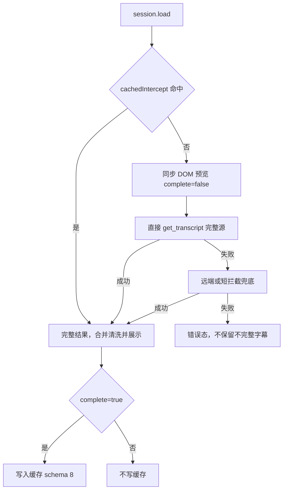

## 产品概览
右栏字幕卡片在打开或切换视频后，快速显示从开头到结尾完整、按句子组织的内容；加载中不出现无意义的重复提示，页面不再残留自动弹出的 YouTube 原生 Transcript 面板。用户无需通过「清空缓存并重新抓取」才能得到完整字幕。

## Core Features
- 完整字幕：优先使用一次性返回全部分段的结构化字幕数据，避免只读到虚拟列表当前视口、丢失前段。
- 快速呈现：已有完整捕获时立即显示；页面上已渲染的字幕可先同步预览，再由完整结果替换。
- 面板收起：脚本不再把「点击打开原生面板、轮询、滚动」作为常规流程；确需触碰原生面板时，成功、失败或中断后都验证式收起。
- 句子级合并：把 2–4 秒的 ASR 碎片按标点、停顿和长度合并成可读句子；显示、搜索、复制、导出和点击跳转都使用同一份结果。
- 缓存可信：残缺预览不写缓存、不命中为最终结果；旧的不完整缓存自动失效，无需手动清空缓存。
- 状态稳定：切换视频、强制重抓、翻译语言切换、失败重试和长视频场景都保持当前视频归属正确。


## 技术栈
沿用现有项目：TypeScript、原生 DOM、Tailwind 工具类、Vite 油猴构建、WXT 扩展构建、IndexedDB 缓存、Vitest。不新增依赖，不新增 UI 框架或组件库。

## 实现方案
核心策略是把「完整结构化数据」与「快速 DOM 预览」分开，不再依赖滚动虚拟列表来凑全字幕：

1. 复用 `src/core/harvest/get-transcript.ts` 的 `fetchGetTranscript()`、`parseGetTranscript()` 和扩展端已有的 `GET_TRANSCRIPT` 桥接，作为一次请求即可拿到全部分段、精确 `startMs` 与 `endMs` 的完整数据源。用户此前打开的原生面板若已产生 `get_transcript` 捕获，`cachedIntercept` 可 0ms 命中。
2. 重写 `src/core/harvest/chain.ts` 中上一轮留下的半成品顺序：清理恒为死代码的 `PANEL_INTERCEPT_WAIT_MS` 与未接线的 `ensurePanel()` 分支，改为「翻译优先时先走远程 → 已有完整捕获 → 同步 DOM 预览 → 直接 get_transcript → 远端或短拦截兜底 → 错误态」。不再叠加第二套逻辑。
3. `src/core/dom/native-panel.ts` 简化为「只读页面上已经渲染的可见文本」：删除轮询、主动点击 `openTranscriptPanel`、60 屏滚动和 `collectAllFromList` 全量扫描；新增同步快照函数，带 `videoId` 归属校验与 `avoidSignature` 内容指纹校验，结果标记为不完整预览。
4. 预览通过 `onPreview` 回传给 `src/platform/session.ts`，只临时更新状态，不写缓存、不作为最终成功结果；完整结果到达后替换预览。切换视频、重试或中止时沿用现有 `inflight` 与 AbortSignal 守卫，旧预览或旧结果不得覆盖新视频。
5. 合并逻辑落在 `src/core/format/copy.ts` 的 `cleanLines()`：先 `stripA11yDuration()`，再调用新增于 `src/core/lines.ts` 的 `mergeFragments()`。按句末标点、最大字符数、相邻停顿和最大行时长合并；保留首段 `start`，用末段结束时间重算 `dur`，保证点击跳转、播放高亮、SRT 导出仍准确。中文边界不加空格，英文边界补空格，输出按时间有序，复杂度 O(n)。
6. 缓存层增加明确的可信标记：`SourceOutcome.complete`、`PanelState.complete` 和 `CachedTranscript.complete`。`CACHE_SCHEMA` 从 7 升到 8，一次性作废历史坏缓存；`readCacheForVideo()` 只返回 `complete=true` 的条目，`writeCache()` 拒绝不完整或非结构化来源。`applyResult()` 仅缓存全量结果，缓存里存清洗后的原始行，展示时再合并，避免反复合并导致过度粘连。
7. 原生面板收起改为可验证：`src/core/dom/panel.ts` 新增异步重试关闭函数，点击候选关闭按钮后等待并检查展开状态，最多重试三轮；`HarvestDeps.closePanel` 改为可返回 Promise，`chain.ts` 的 `finally` 必须 await。常规路径不主动开面板；最后兜底若确实打开，成功、失败或中断都收起。只点击 YouTube 自己的按钮，不隐藏或移除其 DOM 节点。
8. 速度优化：把 `session.load()` 里每次必经的 `waitForPlayerReady(12000)` 与 `waitForVideo(10000)` 从主路径移除；完整结构化源不依赖播放器就绪，DOM 预览仍用 `readPlayerVideoId()` 做归属校验。直接 get_transcript 给每个请求设置短超时、页面自带 params 优先、请求数量有上限，同时保留 `tests/parse.test.ts` 对静态客户端至少尝试三次的断言。最坏等待从「12 秒加 10 秒加 12 轮轮询与 60 屏滚动」收敛到「一次短网络请求加一次线性合并」。
9. 翻译场景保持既有 `preferRemote`：用户选择中文且视频无中文原生轨道时，远程翻译先跑；直接 get_transcript 结果语言与目标语言不符时跳过，避免「切中文显示英文」。`SourceName` 不扩容，直接结构化结果复用既有 `innertube` 标签。

## 实施要点
- 复用现有 `log()`、诊断文本、STAGE_TEXT、IndexedDB、桥接协议和 `contentSignature`；不新增日志系统，不记录字幕正文或用户信息，每层只留耗时、错误码和来源。
- DOM 预览最多一次同步遍历；使用 `snapshotTranscriptText(doc, quick)` 路径，避免 `deepElements` 反复全页扫描。合并为单次线性遍历，避免额外重渲染。
- 保留 500ms `reconcile()` 自愈循环、切页前记录内容指纹、写入归属守卫和 `transcriptFitsDuration()` 物理一致性校验。
- 不完整结果只用于临时预览；所有完整来源都失败时进入错误态并清空临时字幕，防止再次把缺前段内容当成成功结果。
- 控制改动范围：不改 YouTube DOM 结构，不新增 UI 元素，不删除 `.codebuddy`，不改折叠状态机，不还原已删除的诊断转储模块。
- 当前 `dist` 与工作区源码不一致，且 `chain.ts` 有未构建半成品；最终必须用现有 `npm run build` 的 clean 流程重建，版本号从 2.24.0 升到 2.24.1。

## 架构设计


## 目录结构
```
project-root/
├── src/
│   ├── core/
│   │   ├── types.ts                         # [MODIFY] 给 SourceOutcome 与 PanelState 增加 complete 标记，明确全量结果和临时预览的边界
│   │   ├── lines.ts                         # [MODIFY] 新增 mergeFragments，单次线性合并 ASR 碎片，保留首段 start 与准确 dur
│   │   ├── cache/
│   │   │   └── index.ts                     # [MODIFY] CACHE_SCHEMA 升到 8，CachedTranscript 增加 complete；读写都只接受全量条目
│   │   ├── dom/
│   │   │   ├── native-panel.ts              # [MODIFY] 改为同步只读已渲染文本，删除点击开面板、轮询、滚动和全量扫描路径
│   │   │   ├── scrape.ts                    # [MODIFY] 移除 collectAllFromList 与 findScroller，避免虚拟列表滚动带来的缺行和耗时
│   │   │   └── panel.ts                     # [MODIFY] 增加展开判定与验证式异步收起，供切页和 finally 可靠调用
│   │   ├── format/
│   │   │   └── copy.ts                      # [MODIFY] cleanLines 统一做清洗与合并；新增仅清洗函数供缓存写入使用
│   │   └── harvest/
│   │       ├── chain.ts                     # [MODIFY] 清理半成品分支，加入 structured、domPreview、onPreview，重排完整源优先链路
│   │       ├── sources.ts                    # [MODIFY] 拦截和远程成功结果标记 complete，保留翻译语言校验
│   │       ├── get-transcript.ts             # [MODIFY] 增加单请求短超时与尝试上限，页面 params 优先，保留静态客户端诊断
│   │       └── parse/
│   │           └── transcript.ts             # [AFFECTED] 复用现有 parseGetTranscript，不改解析规则
│   ├── platform/
│   │   └── session.ts                       # [MODIFY] 移除主路径长等待，接入预览回传、complete 状态、仅全量写缓存与结果替换守卫
│   └── ui/
│       └── statusbar.ts                     # [AFFECTED] 复用既有来源标签与诊断入口，不新增可见提示
├── userscript/
│   └── main.ts                              # [MODIFY] 接入直接 fetchGetTranscript、同步预览、完整标记、可选最后兜底及收起
├── entrypoints/
│   ├── content.ts                           # [MODIFY] 通过 GET_TRANSCRIPT 桥接接入完整源、预览与可靠收起
│   └── bridge.content.ts                    # [MODIFY] GET_TRANSCRIPT 返回 complete 与既有来源标签，失败安全返回空结果
├── tests/
│   ├── chain.test.ts                        # [MODIFY] 改为断言完整源优先、预览不短路、不主动开面板、finally 等待收起
│   ├── lang-switch.test.ts                  # [MODIFY] 保持翻译优先与语言不匹配不误命中
│   ├── video-id-guard.test.ts               # [MODIFY] 适配只读快照与切页跳过语义
│   ├── stale-signature.test.ts              # [MODIFY] 保持内容指纹对旧面板文本的拦截
│   ├── copy-shared.test.ts                  # [MODIFY] 增加清洗与合并后复制格式断言
│   ├── parse.test.ts                        # [MODIFY] 保留静态客户端尝试与页面 params 优先断言
│   ├── merge-fragments.test.ts              # [NEW] 覆盖句子边界、长停顿、中文拼接、时间范围与 SRT 所需 dur
│   ├── cache-complete.test.ts               # [NEW] 覆盖 schema 8、残缺不写入、旧条目失效、完整条目命中
│   ├── dom-preview.test.ts                  # [NEW] 覆盖同步预览、指纹拦截、预览不写缓存、完整结果替换
│   └── panel-close.test.ts                  # [NEW] 覆盖收起重试、finally 调用与失败不抛错
├── README.md                                # [MODIFY] 更新抓取顺序、缓存可信标记、句子合并、面板收起与构建说明
├── package.json                             # [MODIFY] 版本升到 2.24.1，脚本沿用 clean 后构建
└── dist/                                    # [AFFECTED] 重新生成 userscript 与 extension 全部产物，不保留旧哈希文件
```

## 关键接口
```ts
interface SourceOutcome {
  lines: TranscriptLine[];
  source: SourceName;
  track?: CaptionTrack;
  showTimestamps: boolean;
  failures?: FailureRecord[];
  complete: boolean;
}
```

```ts
interface CachedTranscript {
  key: string;
  videoId: string;
  lang: string;
  kind: string;
  title: string;
  source: string;
  lines: TranscriptLine[];
  chapters?: Chapter[];
  showTimestamps: boolean;
  savedAt: number;
  expiresAt: number;
  complete: boolean;
}
```

`HarvestDeps` 新增：返回完整结构化结果的 `structured`、同步返回不完整预览的 `domPreview`、把预览回传给会话的 `onPreview`；`closePanel` 允许返回 Promise 并由链路等待。`SessionHooks.harvest` 的 options 增加 `onPreview` 透传，不新增公开平台 API。


## Agent Extensions
### SubAgent
- **code-explorer**
  - Purpose: 以 very thorough 级别跨文件核对抓取链、缓存读写、两个宿主接线、原生面板收起、合并清洗入口、现有测试与 README 的全部引用点。
  - Expected outcome: 产出精确的修改清单、调用链图与受影响测试清单，确认半成品 `chain.ts` 分支、已存在的 `GET_TRANSCRIPT` 桥接和 `fetchGetTranscript` 可复用，避免漏改或重复实现。
