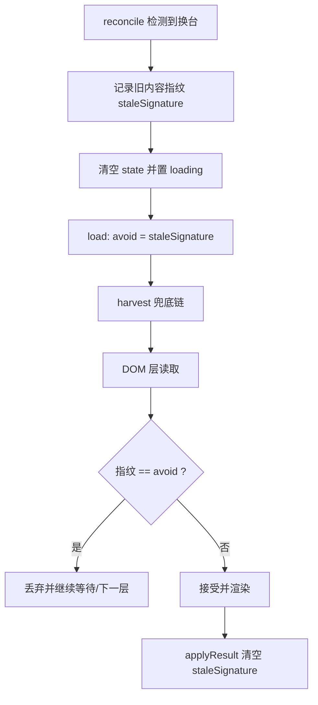

## 产品概览
修复切换视频后字幕仍显示上一条视频内容的问题，同时精简面板文案、清理工程中残留的旧版实现痕迹。

## 核心功能

### 1. 切页后字幕必须属于新视频
- 点击推荐视频、相关视频或任何站内跳转后，面板先进入「加载中」并清空旧行，再展示新视频字幕。
- 关键约束：YouTube 在站内跳转时不会销毁已经展开的原生字幕面板，面板里仍是上一条视频的文字，且没有任何视频标识。判定新旧只能靠「内容是否与切换前完全相同」。
- 凡是与切换前内容一致的结果一律丢弃并继续等待，宁可显示「抓取失败/没有字幕」，也不能把上一条视频的字幕配上新视频的标题。
- 面板关闭成功、随后由我们重新打开并重新渲染的情况，视为可信内容，不会被误判丢弃。

### 2. 去掉多余的来源提示
- 头部副标题不再出现「来自页面上已渲染的字幕面板」「章节来自页面信息」这类描述。
- 就绪状态下副标题整行隐藏（不留空行、不占高度）；只有「抓取中…（当前阶段）」和「抓取失败」才显示文字。
- 底栏的 `DOM` 等缩写与其悬停解释保持不变，信息不丢失，只是不再在头部重复叙述。

### 3. 清理旧版实现残留
- 源码中不再保留 `legacy` 命名的模块与导出（改为描述当前职责的名字），文档同步更新。
- 删除空目录与陈旧的旧构建目录，构建流程先清理产物再产出，避免历史文件与新产物混在一起。
- 交付标准：生成物（油猴脚本、浏览器扩展各文件）与源码树中都不再出现旧版实现的文件名、导出名、按钮标识与全局变量。


## 技术栈
沿用现有栈：TypeScript + 原生 DOM（无框架）+ Tailwind 工具类 + Vite（userscript）/ WXT（extension）+ Vitest。不引入新依赖。

## 实现方案

### 一、切页残留：内容指纹守卫（核心）

问题链路（已核实）：

```
reconcile() 检测到换视频 → 清空 state.lines + switchPending = true
  → load() 传 staleRisk → harvest → extractTranscriptLegacy({ skipSnapshot })
    → skipSnapshot 只跳过「第一次」快照
    → 随后的轮询 / openTranscriptPanel 仍然直接读页面
      → 读到尚未销毁的旧面板 → 旧行被当作新视频字幕
```

`staleVideoNote()` 比对的是「播放器 id vs 期望 id」，切页后播放器已切到新视频，这道守卫必然放行，因此必须换成**与内容本身绑定**的判据。

**方案：切换瞬间记下旧内容的指纹，DOM 层的每一次读取都必须通过指纹校验。**

1. 新增 `src/core/format/fingerprint.ts`
   ```ts
   export function contentSignature(lines: TranscriptLine[]): string;
   export function textSignature(text: string): string;
   ```
   归一化后再算 FNV-1a：先 `stripA11yDuration`、合并空白、去行首时间码、统一小写，再对**整段**文本取哈希。用整段而非前几行，是为了避免「两条视频开头恰好相同」被误杀（整段完全一致只可能来自同一份内容）。

2. `src/platform/session.ts`
   - 新增 `let staleSignature: string | null = null`；
   - `reconcile()` 的换台分支里，**在清空 state 之前** `staleSignature = contentSignature(current.lines)`（`lines` 为空则置 `null`）；
   - `load()` 计算 `const avoid = force ? null : staleSignature`，随 `{ staleRisk, avoid }` 传给 `hooks.harvest`；
   - `applyResult()` 成功后 `staleSignature = null`（避免下一次无关的重试被误伤）；
   - `HarvestOptions` 增加 `avoid?: string | null`。

3. 两个宿主透传：`userscript/main.ts:63`、`entrypoints/content.ts` 调用处补 `avoidSignature: options?.avoid ?? null`。

4. `src/core/dom/legacy.ts`（本轮重命名为 `native-panel.ts`）
   - `LegacyExtractOptions` 增加 `avoidSignature?: string | null`；
   - 私有 `isDuplicateOfPrevious(text: string): boolean`；
   - 校验点覆盖三条读取路径，缺一不可：
     - ⓪ 首屏快照；
     - ② 轮询快照（命中指纹则**忽略并继续轮询**，不 break）；
     - ③ `openTranscriptPanel` + `collectFromList` 的结构化读取；
   - 需要「重新打开过」的例外：`openTranscriptPanel()` 返回的面板若本次确实点了触发器（`getTriggerInfo()` 以「点击触发器」/「展开简介后点击触发器」开头），说明 YouTube 已按新视频重建，此时跳过指纹校验，避免「两条视频字幕恰好一致」被误杀；
   - 全部被拒时返回 `{ lines: [], showTimestamps: false }`，并在 `getLegacyDiagnostic()` 里写清「丢弃与上一条视频相同的内容（原生面板尚未重建）」，让诊断面板能解释失败原因。

5. `src/core/dom/panel.ts`：`discardStaleTranscriptPanel()` 增加兜底——`pickPanel()` 失败时，再按 `[target-id*="transcript"]` 找可见面板并点击其关闭按钮；仍失败就返回 false（不隐藏、不改 YouTube 的 DOM 结构）。

### 二、去掉头部来源提示

- `src/ui/panel.ts` 的 `subtitleText()`：仅保留 `error → '抓取失败'`、`loading/idle → state.progress || '抓取中…'`；就绪态返回空串（不再区分 chapters / source）。
- `src/ui/header.ts`：`setSubtitle(text)` 内部 `show(subtitleEl, text.length > 0)`，空串即整行隐藏，标题仍垂直居中。
- `src/ui/labels.ts`：删除已无引用的 `SOURCE_DESC`；`SOURCE_HINT`（底栏 `sourceRow.title` 悬停解释）保留。

### 三、清理旧版实现痕迹

- 删除空目录 `src/legacy/`、陈旧构建目录 `.output/`（当前 `dist/` 为准）。
- 模块重命名（消除 legacy 字样，保留职责语义）：
  - `src/core/dom/legacy.ts` → `src/core/dom/native-panel.ts`
  - `extractTranscriptLegacy` → `extractFromNativePanel`
  - `getLegacyDiagnostic` → `getDomDiagnostic`
  - `LegacyExtractOptions/Result` → `NativePanelOptions/Result`
  - 同步更新 `src/platform/session.ts`、`userscript/main.ts`、`entrypoints/content.ts`、相关 tests。
- `package.json`：新增 `clean` 脚本（`node -e` 删除 `dist` 与 `.output`，不引入 rimraf），`build` 改为 `npm run clean && npm run icons && npm run build:ext && npm run build:userscript`，保证产物目录不混入旧哈希 chunk。
- `README.md`：更新切页归属说明（内容指纹）、副标题行为、模块命名与构建流程；删除仍提到旧脚本/同步脚本的段落。

## 性能与可靠性

- 指纹只在「换台」时计算一次（O(n)，一条 10 万字符字幕约 1ms 以内），随后每次 DOM 读取只做一次字符串比较 + 一次哈希，成本可忽略。
- 轮询命中指纹时不中断循环（继续等 YouTube 重建），最多 12 × 250ms，与原逻辑时长一致，不会因为守卫而变慢。
- 误杀风险控制：整段哈希只在**完全一致**时命中；「由我们重新打开过面板」时直接放行。
- 不修改 YouTube 的 DOM 结构（不 hide/remove 其面板节点），只做关闭点击，避免与官方 UI 状态不一致。

## 架构设计



## 目录结构

```
src/core/format/fingerprint.ts        # [NEW] 内容指纹
src/core/dom/native-panel.ts          # [RENAME] 原 legacy.ts
src/core/dom/panel.ts                 # [MODIFY] 关闭旧面板兜底
src/platform/session.ts               # [MODIFY] 记录/传递/清除指纹
userscript/main.ts                    # [MODIFY] 透传 avoidSignature
entrypoints/content.ts                # [MODIFY] 透传 avoidSignature
src/ui/panel.ts                       # [MODIFY] 副标题精简
src/ui/header.ts                      # [MODIFY] 空串隐藏副标题
src/ui/labels.ts                      # [MODIFY] 删除 SOURCE_DESC
package.json                          # [MODIFY] clean + build
README.md                             # [MODIFY] 文档同步
tests/stale-signature.test.ts         # [NEW] 切页残留回归
tests/*                               # [MODIFY] 改名后的 import
```

## 实施要点

- `session.ts` 里必须在 `store.setState({...emptyPanelState(...)})` **之前**取指纹，否则旧行已被清空，指纹永远为空。
- `legacy.ts` 内 `switchToTranscriptTab()` 之后、面板未真正重建时，轮询必须持续被指纹挡住；日志/诊断要能看出「挡住了几轮」。
- 改名涉及面较广，建议一次性 `grep` 全部引用点后再动手，避免漏改导致 `tsc` 失败。
- 交付前跑 `tsc --noEmit`、`vitest run`、`npm run build`，并核对产物中已无 `legacy`、`__yttLegacyV19`、`Copy Transcript`、`copy-transcript-btn` 字样，版本号 +0.1。

