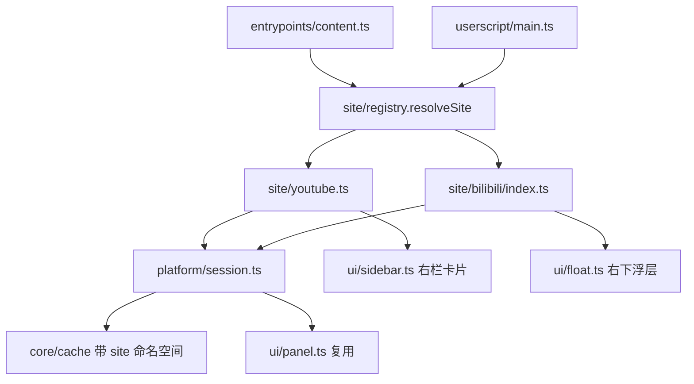

## 用户需求
把目前只服务 YouTube 的字幕工作台改造成**多站点**架构，第一个新增站点是哔哩哔哩；要的是真正的模块化（抽出站点契约、YouTube 也迁进去），而不是再堆一个 if-else 分支。

## 产品概述
同一套面板（搜索、命中跳转、时间戳、复制、导出、7 天缓存）在 YouTube 与 B 站都能用；两站各自走自己最可靠的取字幕通路，用户不需要感知差异。B 站用右下角浮层卡片，YouTube 保持现有右栏卡片形态。

## 核心功能
- **站点自动识别**：打开支持站点的视频页即生效，无需手动切换；不支持的页面不注入入口按钮。
- **B 站字幕抓取**：优先官方接口（WBI 签名 + 登录态），拿到视频全部字幕轨（投稿字幕 / AI 字幕 / 多语言），默认挑质量最高的一条；接口不可用时退回页面内已有数据，并说明降级原因。
- **轨道切换**：一条视频有多条字幕轨时可在面板内切换，列表、复制、导出同步更新。
- **能力降级**：B 站没有章节、没有章节缩略图、不支持机器翻译，对应控件与区块自动隐藏，不出现点不动的按钮。
- **一致的内容能力**：搜索与命中计数、点击行跳转播放、时间戳开关、复制全文、导出 txt/md/srt/json 在两站完全一致。
- **分 P 视频**：按当前播放分集取对应字幕，切集后自动跟随，绝不复用上一集内容。
- **缓存隔离**：两站字幕各自缓存互不命中；站内仍按语言/轨道区分。
- **可诊断的错误**：未登录、接口风控、AI 字幕未生成、页面无字幕分别给出可执行提示。

## 视觉与交互
- B 站：右下角胶囊入口按钮（沿用现有交付语言：红橙渐变 + 字母 Y 图标），点击展开浮层卡片，可收起；浮层与站点样式完全隔离。
- 面板内部视觉、字体、行高、深浅主题与 YouTube 端保持一致，两站看起来是同一个产品。
- 切站或切视频时旧内容按「陈旧数据闸门」整体退场，不残留上一个视频的字幕。


## 技术栈
沿用现有栈，不新增运行时依赖：WXT 0.21 + 原生 TypeScript + Tailwind（仅构建期）+ Vitest；`package.json` 的 `dependencies` 保持为空。

## 实现策略
核心是一次**依赖倒置**：`Session`（会话/缓存/切页对账/播放跟随）不再直接 import YouTube 的 DOM 读取函数，只依赖 `SiteAdapter` 契约；YouTube 现有实现整体搬进 adapter，行为零改动；B 站是第二个实现。



关键决策与理由：
1. **adapter 只描述站点差异，不描述播放器细节**。接口含 `videoIdOf / playerVideoId / title / duration / chapters / storyboard / availableLangs / langPlan / capabilities / harvest / closeNativePanel / mount / cacheNamespace`；YouTube 内部继续用 `readPlayerResponse`、`installTimedTextHook`、`get_panel`，B 站内部用自己的 WBI 客户端。这样 session 彻底去站点化，又不必重写已经调优过的抓取链。
2. **harvest 复用现有兜底链骨架** `harvestTranscript(deps)`，adapter 只填 `structured / remote / domPreview / domFallback / closePanel`。B 站：`structured` = WBI `player/wbi/v2` → `subtitle_url`；`remote` = `__INITIAL_STATE__.videoData.subtitle.list`；`domPreview/domFallback` = 播放器字幕面板已渲染文本；不填 `intercept`（链自动跳过）。`complete:false` 语义原样复用。
3. **缓存加站点命名空间并抬 schema**：key 从 `v8|videoId|lang|kind` 变为 `v9|site|videoId|lang|kind`。抬版本让旧缓存一次性失效（7 天缓存，可接受），换取「YouTube 11 位 id 与 B 站 BV 号+分P 永不相撞」。写入守卫继续用 `adapter.playerVideoId()`。
4. **B 站接口层纯函数化**：`md5` / `signWbi` / `parseSubtitleBody` / `parseBiliVideoId` 均无副作用，可直接单测（MD5 用标准向量锁死）；网络只在一个 `fetchJson` 包装里。
5. **油猴保持 `@grant none`**：一旦声明任何 `@grant`，Tampermonkey 会沙箱化脚本，YouTube 的 `getPlayerResponse()`、fetch hook、A 方案切 CC 轨道全部失效。B 站因此用页面上下文 `fetch(..., { credentials:'include' })`（`api.bilibili.com` 与 `www.bilibili.com` 同站，SameSite 放行），失败时给明确诊断而非静默降级。
6. **扩展端用 `host_permissions` 拿 CORS 豁免**：B 站 content script 在 ISOLATED world，`host_permissions` 覆盖 `www.bilibili.com` 与 `api.bilibili.com` 即可带 cookie 请求；只有页面兜底的 `__INITIAL_STATE__` 属于页面世界，用极小的 MAIN world reader 回 `BILI_STATE`，不复制 YouTube 那套完整 bridge。
7. **UI 只加挂载壳**：`createPanel` 已支持 `variant:'overlay'`，新增 `src/ui/float.ts`（shadow root + 右下固定 + 折叠态存 sessionStorage），与 `sidebar.ts` 同构同 API。

### 性能与可靠性
- B 站一次完整抓取最多 3 个请求：`view`（可从页面状态免请求取 bvid/cid/title）→ `nav`（WBI key，10 分钟内复用）→ `player/wbi/v2` → `subtitle_url`。轨道列表缓存 60s，字幕体沿用 7 天缓存；切轨不重复打 WBI。
- WBI 签名是纯同步计算（64 次查表 + 一次 MD5），不构成热点；签名只覆盖 query，不含字幕正文。
- 面板沿用虚拟列表，切轨只重建索引（O(n)），不逐行重建 DOM。
- 失败分级：未登录（`-101`）/ 风控（`-352`，建议退避重试）/ 无字幕（AI 生成中）/ CORS 或网络错误，都写进 `failures` 与底栏诊断，不抛裸异常。

### 已知风险与对策
| 风险 | 对策 |
| --- | --- |
| 未登录时 `nav` 返回 `code:-101` 但 `data.wbi_img` 仍可用 | 取 WBI key 不做严格 `code===0` 校验；只在取字幕结果时严格校验 |
| WBI 表/字段随版本变化 | 签名集中在 `wbi.ts`，配一条「固定输入复算固定签名」的回归测试，改动面收敛到一个文件 |
| `subtitle_url` 的 `auth_key` 约 7 分钟过期 | 拿到轨道列表立刻下载选中轨；切轨重新走 `player/wbi/v2` |
| 页面内 fetch 被 CORS/风控挡 | 明确报错并提示登录/稍后重试；扩展端因 `host_permissions` 不受此限 |
| 分 P cid 不同 | `videoIdOf` 返回 `BV...:p{n}`，缓存与归属校验都以它为准 |
| content script 不能代码分割，B 站模块进主包 | B 站模块精简（目标 +8KB 内），按需引入，YouTube 侧零改动 |

## 关键代码结构

```ts
// src/core/site/types.ts —— 站点契约（session 与 UI 只认这一层）
export interface SiteCapabilities {
  chapters: boolean;          // 章节 / 章节缩略图
  storyboard: boolean;        // 缩略图雪碧图
  machineTranslate: boolean;  // 是否支持 tlang 机翻
  ccTrackSwitch: boolean;     // 是否会主动切 CC 轨道（B 站 false）
}

export interface SiteAdapter {
  readonly id: string;        // 'youtube' | 'bilibili'
  readonly capabilities: SiteCapabilities;
  readonly cacheNamespace: string;
  match(url: URL): boolean;
  videoIdOf(location: Location): string | null;   // B 站：BV1xx:p2
  playerVideoId(win: Window): string | null;      // 写缓存的归属守卫
  title(win: Window, videoId: string): string;
  duration(win: Window): number | null;
  chapters?(win: Window): Chapter[];
  storyboard?(win: Window, videoId: string): Promise<string | null>;
  availableLangs(win: Window, videoId: string): string[];  // 已归一化：ai-zh 归为 zh-Hans
  langPlan(choice: LangChoice): LangPlan;         // B 站：tlang 恒为 null
  harvest(input: HarvestInput): Promise<HarvestResult>;
  closeNativePanel?(win: Window): Promise<unknown>;
  mount(input: MountInput): SitePanelHandle;      // 右栏卡片 / 右下浮层
}
```

```ts
// src/core/site/bilibili/types.ts —— 只保留必要字段，避免 any 扩散
export interface BiliTrack { lan: string; lan_doc?: string; subtitle_url?: string; type?: number }
export interface BiliView {
  bvid: string; aid: number; title: string;
  pages?: { cid: number; page: number; part?: string }[];
}
```

## 目录结构

```
src/
├── core/
│   ├── site/                              # [NEW] 站点层
│   │   ├── types.ts                       # [NEW] SiteAdapter / SiteCapabilities / HarvestInput / MountInput / SitePanelHandle 契约；纯类型
│   │   ├── registry.ts                    # [NEW] resolveSite(win)：按 host 选 adapter；未知站点返回 null；导出全部站点供测试枚举
│   │   ├── youtube.ts                     # [NEW] YouTube adapter：把 player.ts / get-panel.ts / dom/* 组装成契约实现；
│   │   │                                  #       capabilities 全 true；cacheNamespace='youtube'；mount 走 sidebar；
│   │   │                                  #       harvest 逻辑从 content.ts 与 userscript/main.ts 中抽出来（两端复用同一份）
│   │   └── bilibili/
│   │       ├── index.ts                   # [NEW] B 站 adapter：videoIdOf（含 ?p=）、title、duration、availableLangs（归一化）、
│   │       │                              #       langPlan（无 tlang）、capabilities（chapters/storyboard/machineTranslate/ccTrackSwitch 全 false）、
│   │       │                              #       harvest 组装、mount 走浮层、cacheNamespace='bilibili'
│   │       ├── md5.ts                     # [NEW] 手写 MD5（WebCrypto 不支持）；标准向量自测
│   │       ├── wbi.ts                     # [NEW] MIXIN_KEY_ENC_TAB、keyFromUrl、signWbi(params, imgKey, subKey)，含 10 分钟 key 缓存
│   │       ├── api.ts                     # [NEW] fetchJson（credentials:'include'、Referer、20s 超时、状态码分类）；
│   │       │                              #       fetchView / fetchWbiKeys / fetchPlayerTracks / fetchSubtitleBody
│   │       ├── parse.ts                   # [NEW] parseBiliVideoId → { bvid, page }；parseSubtitleBody → TranscriptLine[]（秒转毫秒、剥内联标签、过滤空文本）；
│   │       │                              #       normalizeTrack：ai-zh → { languageCode:'zh-Hans', kind:'asr' }，type===0 → kind:'manual'
│   │       ├── page-state.ts              # [NEW] 页面兜底：读 __INITIAL_STATE__.videoData.subtitle.list 与播放器已渲染字幕面板，
│   │       │                              #       返回 complete:false 的 SourceOutcome（绝不写缓存）
│   │       └── errors.ts                  # [NEW] 错误映射：-101 未登录 / -352 风控 / 空 subtitles（AI 生成中）/ CORS → 可读 detail
│   ├── cache/index.ts                     # [MODIFY] cacheKey 加 site 段并抬 schema 到 v9；readCacheForVideo/writeCache 增 site 参数
│   ├── types.ts                           # [MODIFY] PanelState 增 site 字段；SourceName 不变（B 站映射到 innertube/player/dom）
│   └── dom/button.ts                      # [MODIFY] 抽出可复用的按钮外观构造，供浮层入口复用；YouTube masthead 逻辑保留
├── platform/
│   ├── session.ts                         # [MODIFY] 去掉 player.ts / dom/panel.ts / format/copy.ts 直接 import，改经 adapter 取
│   │                                      #          videoId / playerVideoId / duration / chapters / availableLangs / title / storyboard / closeNativePanel；
│   │                                      #          createSession({ win, adapter })；缓存读写带 adapter.cacheNamespace
│   └── types.ts                           # [MODIFY] 新增 SitePanelHandle（ensureMounted/show/hide/toggle/isOpen/destroy）；TranscriptClient 不变
├── ui/
│   ├── float.ts                           # [NEW] 右下浮层挂载：shadow root 隔离、固定定位、折叠态存 sessionStorage（按站点分键）、窄屏自适应；
│   │                                      #       createPanel({ variant:'overlay' })
│   ├── float-button.ts                    # [NEW] 浮层入口胶囊按钮：复用按钮外观、状态同步、错误闪烁提示（对应 flashEntryButton）
│   ├── toolbar.ts                         # [MODIFY] 按 capabilities 降级：无章节则隐藏视图切换；无机翻时语言按钮给「该站点无机器翻译」提示而非假可用
│   └── panel.ts                           # [MODIFY] PanelOptions 增 site 与 capability 透传；storyboard 缺失时不渲染缩略图区块
├── entrypoints/
│   ├── content.ts                         # [MODIFY] matches 增加 bilibili；按 resolveSite 选 adapter；harvest 与挂载交给 adapter
│   └── bridge.content.ts                  # [MODIFY] 保持 YouTube MAIN world 职责；新增 BILI_STATE handler（仅 B 站 host 注册），回 __INITIAL_STATE__ 摘要
└── userscript/main.ts                     # [MODIFY] 改为 resolveSite + adapter.mount；YouTube 专用 hook 安装下移到 youtube adapter 内部

tests/
├── site-registry.test.ts                  # [NEW] host → adapter；未知站点 null；videoIdOf 覆盖 watch/shorts/BV/分P
├── bilibili-wbi.test.ts                   # [NEW] MD5 标准向量；signWbi 固定输入复算固定 query；参数排序与 !'()* 清理
├── bilibili-parse.test.ts                 # [NEW] 字幕 JSON → TranscriptLine（秒转毫秒、剥标签、空文本过滤）；track 归一化；错误码映射
├── cache-namespace.test.ts                # [NEW] 两站同 id 段不互撞；v9 前缀生效；complete:false 不写不读
└── session-adapter.test.ts                # [NEW] 注入假 adapter，验证 session 不再读 YouTube DOM：切页对账、陈旧闸门、语言过滤

wxt.config.ts                              # [MODIFY] host_permissions 增加 www.bilibili.com 与 api.bilibili.com
vite.userscript.config.ts                  # [MODIFY] meta 增加 B 站 @match，保持 @grant none；产物命名与 README 同步
README.md                                  # [MODIFY] 新增「多站点」章节：能力矩阵、B 站限制（登录/风控/CORS/@grant none 原因）
```

## 执行注意
- **回归优先**：先抽接口、再改 session、最后接 B 站；每步 `npx vitest run` 必须全绿，YouTube 行为的四条不变量逐条对照（陈旧指纹闸门、`complete:false` 不进缓存、语言不符丢弃、`playerVideoId` 归属守卫）。
- **不动 `harvest/chain.ts` 语义**：B 站只替换 deps 来源，顺序、错误码决策、`closePanel` 在 finally 的行为都不改。
- **`@grant none` 是硬约束**：不要引入 `GM_xmlhttpRequest`；跨域走页面 fetch + `credentials:'include'`，失败给「请确认已登录 / 稍后重试」。
- **登录态判定**：B 站字幕接口匿名返回空列表而非报错，诊断文案必须区分「未登录」与「视频没有字幕」。
- **分 P**：`videoIdOf` 必须带分 P，否则第 2 P 命中第 1 P 的缓存；`playerVideoId` 用播放器 bvid + 当前 p 组合。
- **浮层只做 `position: fixed`，不改站点 body 样式**；shadow root 内自带 `styles.css`，避免双向样式污染。
- **体积**：B 站模块按需引入且不含 UI 组件；content.js 超出 110KB 时优先压缩 B 站注释与路径字符串，而不是拆 world。

