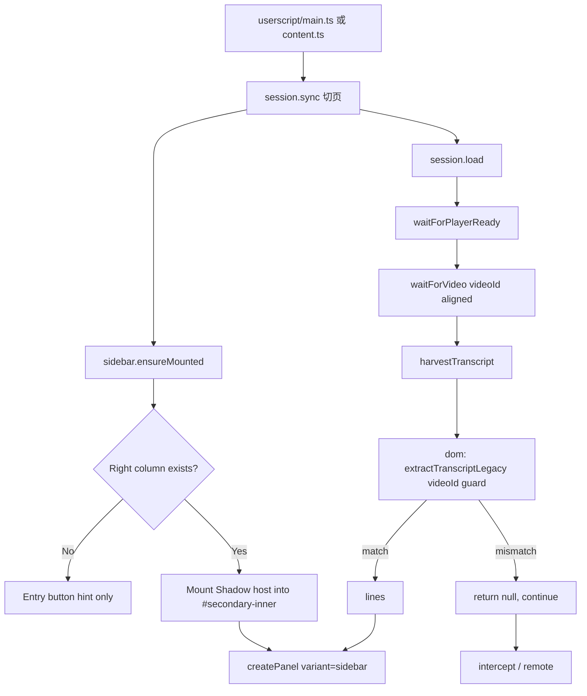

## 用户需求
- 页面内字幕面板不再以悬浮弹窗形式出现，改为嵌入 YouTube 观看页右栏（相关视频那一列）的顶部，外观与 YouTube 自带字幕面板一致，作为页面内容随页面滚动，而不是盖在视频上。
- 从「相关视频」切到另一个视频时，面板保持打开，自动抓取当前视频的字幕并替换内容；不得出现上一个视频的字幕。
- 没有右栏的页面（Shorts、无相关视频列等）不显示面板，只保留入口按钮，点击时给出不打断操作的提示，不使用阻塞式弹窗。
- 油猴脚本与浏览器扩展的页面内面板统一改为这种嵌入方式；扩展自带的浏览器侧边栏保留不变。

## Product Overview
把原本悬浮在视频右上角的字幕面板，改成 YouTube 右栏里的一张卡片。它像 YouTube 自己的「字幕」面板一样占满右栏宽度、有标题栏和关闭按钮，滚动页面时随右栏一起移动，不再遮挡视频。切换视频时面板不消失，标题与列表自动换成新视频的内容。

## Core Features
- **右栏内嵌卡片**：占满右栏宽度，位于相关视频列表上方，随页面滚动；卡片自身高度受限、内部滚动。
- **折叠与关闭**：标题栏可收起为一条窄条，再次点击恢复；关闭后可用入口按钮重新打开。
- **切页自动跟随**：SPA 切换视频时面板保持展开，自动换成新视频的标题、章节与字幕；加载期间显示骨架，不残留上一个视频的内容。
- **无右栏降级**：找不到右栏时不显示面板，入口按钮给出短暂文字提示。
- **入口按钮**：页面顶部按钮用于展开/收起右栏面板，状态与面板实际显隐保持一致。


## Tech Stack
沿用现有栈，不引入新框架：
- 语言/构建：TypeScript + Vite（WXT 构建扩展、vite 构建油猴单文件）
- 样式：Tailwind CSS v4 + CSS 变量令牌（`src/ui/styles.css`）
- 渲染：原生 DOM（`src/ui/dom.ts` 的 `h()`），Shadow DOM 隔离页面样式
- 测试：Vitest（node 环境 + 手写 fake DOM，沿用 `tests/virtual-list-refresh.test.ts` 风格）

## Implementation Approach

### 1. 新增右栏挂载器 `src/ui/sidebar.ts`（替代 `overlay.ts`）
导出 `createSidebarPanel({ doc, css, client })`：

- **挂载点解析**（纯函数、可单测）：`resolveSidebarMount(doc)` 依次尝试
  `#secondary-inner` → `#secondary` → `ytd-watch-flexy #secondary`，全部缺失返回 `null`。
- **Host 结构**：`<div id="ytt-sidebar-host">` + `attachShadow({ mode: 'open' })`，
  注入 `panelCss`；卡片容器 `width:100%; height:min(560px,70vh); border-radius:12px;
  border:1px solid var(--ytt-border); background:var(--ytt-bg); overflow:hidden;
  margin-bottom:12px`。插入为挂载点的**第一个子节点**（相关视频之上）。
- **高度必须显式**：`src/ui/virtual-list.ts` 依赖 `scroller.clientHeight`（为 0 时回落 600 会错行），
  卡片固定高度是虚拟列表正确的前提；挂载后调用已有的 `panel.relayout()` 重新测量。
- **重挂载**：YouTube 在 SPA 切页/布局切换时会重建 `#secondary-inner`。用
  `MutationObserver` 观察 `ytd-watch-flexy` 的 `childList`（不 observe 全页 subtree），
  配合 rAF 防抖调用 `ensureMounted()`：节点脱离文档就重新插入，**保持展开状态**。
- **展开状态**：内存 + `sessionStorage` 记录 `open`（默认展开）。关闭只隐藏 host、不销毁面板，
  避免每次重开重建几千行索引；`destroy()` 时才断 observer、移除 host、销毁 panel。
- **惰性创建**：首次展开才 `createPanel`，减少未使用时的启动开销。

### 2. 面板新增 `sidebar` 变体（`src/ui/panel.ts`）
- `PanelOptions.variant: 'overlay' | 'sidepanel' | 'sidebar'`；`sidebar` 不加固定定位，
  根节点已是 `flex h-full min-h-0 flex-col`，正好填满卡片。
- 标题栏在 `sidebar` 下显示「收起」按钮（复用已有 `onClose`），`sidepanel` 保持现状。
- 现有 prefs / 搜索 / 视图切换 / 时间戳 / 章节 / 截图逻辑与挂载方式解耦，零改动复用。

### 3. 入口改造（两端一致）
- `userscript/main.ts`：删除 `createOverlay`；按钮 `onClick` 改为
  `sidebar.toggle()`；`mountPoint === null` 时按钮文案临时变「当前页面无右栏」并复原（非阻塞）。
  `tick()` 中 `overlay.hide()` 改为 `sidebar.ensureMounted()` —— **切页不再关面板**。
- `entrypoints/content.ts`：同样替换；页面按钮不再先尝试 Chrome 侧栏（工具栏图标仍走
  `background.ts` 的 `openPanelOnActionClick`，`OPEN_PANEL` 通道保留不动）；
  `wxt:locationchange` 里去掉 `overlay.hide()`，改为 `ensureMounted()` + `session.sync()`。
- 删除 `src/ui/overlay.ts`（已确认除这两个入口外无引用，`OVERLAY_HOST_ID` 无其它引用）。

### 4. 切页取错字幕的根因与修复（核心）
三个缺陷叠加，逐个修：

**(a) 面板被主动关闭** —— 已由第 3 步去掉 `overlay.hide()`。

**(b) 不等播放器切到目标视频** —— `src/platform/session.ts`
- `player.ts` 新增 `readPlayerVideoId(win)`，按优先级取：
  `#movie_player.getVideoData()?.video_id` → `getPlayerResponse().videoDetails.videoId`
  → `ytInitialPlayerResponse.videoDetails.videoId` → `ytd-watch-flexy[video-id]` 属性。
- `load()` 里在 `waitForPlayerReady` 之后加 `waitForVideo(win, videoId, 10000)`：
  轮询 200ms 直到 `readPlayerVideoId === videoId`；超时降级继续，但后续 DOM 快照仍受 (c) 拦截。
- `sync()` 里切页瞬间的 `readChapters(win.document)` 改为 `[]`（此时读到的是旧视频章节），
  由 `load()` 在 videoId 对齐后填充。

**(c) DOM 快照不校验归属** —— `src/core/dom/legacy.ts`
- `extractTranscriptLegacy(doc, options?: { videoId?: string })`，**参数可选以兼容现有测试**。
- 入口与每次 `snapshotTranscriptText` 前后都校验：`options.videoId` 存在且
  `readPlayerVideoId(win) !== options.videoId` → 立即返回空结果并记 note，不读快照。
- `src/core/harvest/chain.ts` 的 `dom` 依赖签名改为 `(videoId: string) => Promise<SourceOutcome | null>`，
  由 chain 把 `ctx.videoId` 传进去；返回空则继续走 intercept / remote（现有逻辑不变）。

**(d) 拦截层归属错标** —— `src/core/harvest/intercept.ts`
- `get_transcript` 的 `videoId` 不再用 `videoIdFromLocation(win)` 猜（切页窗口期会错标）：
  优先 `videoIdFromGetTranscriptBody(bodyHint)`，取不到就留 `null`。
- `waitFor` 的 waiter 匹配从 `if (waiter.videoId && capture.videoId && ...)` 改为
  **归属为 `null` 的 capture 不作为任何 videoId 的命中**（timedtext URL 必带 videoId，不受影响）。

### 5. 性能与稳定性
- 虚拟列表、行高测量、搜索索引均复用现有实现；切页时 `session.load()` 已有的
  `AbortController` + `inflight` 计数会中止上一次抓取，无需新增并发控制。
- `MutationObserver` 只 observe `ytd-watch-flexy` 的直接子节点变化，rAF 防抖，避免 YouTube 频繁重排时反复挂载。
- 关闭面板不销毁 DOM，重开零成本；`destroy()` 才释放。
- 面板宽度自适应右栏（约 400px），不做固定 px。

### 6. 兼容与降级
- 找不到右栏 → 不创建面板，入口按钮给非阻塞提示，`session` 照常抓取（数据仍在，只是不展示）。
- 影院模式/窄窗：`#secondary` 可能被隐藏但仍在 DOM，面板随该列一起隐藏，符合预期。
- 扩展 Side Panel（`entrypoints/sidepanel/*`、`remote-client.ts`）完全不动。

## Implementation Notes
- **改动面控制**：`panel.ts` 只加变体与按钮，不重构内部；`prefs`、`store`、`types` 的 `PanelState` 不需要新字段。
- **兼容旧调用**：`extractTranscriptLegacy` 新参数必须可选，否则会破坏 `tests/legacy*.test.ts`。
- **不要用 `alert`**：无右栏提示走按钮文案 + `title`，2 秒复原。
- **可观测性**：沿用 `deps.log({ code, source, detail })`；videoId 不匹配时记一条
  `detail: 'videoId mismatch: expected=X actual=Y'`，便于用户反馈时定位。
- **不要回归已修问题**：`switchToTranscriptTab` 的「已选中 chip 不再点击」、
  `storyboard` 的档位自增序号、`applyRowState` 的 `data-role` 定位都必须保留。

## Architecture Design



## Directory Structure

```
src/ui/
├── sidebar.ts               # [NEW] 右栏挂载器：解析挂载点、Shadow host、卡片、MutationObserver 重挂、展开状态
├── panel.ts                 # [MODIFY] variant 增加 'sidebar'；sidebar 下标题栏显示收起按钮
├── overlay.ts               # [DELETE] 浮层实现，两个入口均不再引用
└── styles.css               # [MODIFY] 可选新增 .ytt-card 卡片容器样式（高度/圆角/边框）

userscript/main.ts           # [MODIFY] 用 sidebar 替换 overlay；切页保留展开；无右栏给按钮提示
entrypoints/content.ts       # [MODIFY] 同上；页面按钮改为切右栏面板，不再尝试 Chrome 侧栏

src/core/harvest/
├── player.ts                # [MODIFY] 新增 readPlayerVideoId(win)：player/ytInitial/ytd-watch-flexy 四级取值
├── chain.ts                 # [MODIFY] dom 依赖签名加 videoId 参数
└── intercept.ts             # [MODIFY] get_transcript 不再用 location 猜归属；waitFor 跳归属为 null 的 capture

src/core/dom/legacy.ts       # [MODIFY] extractTranscriptLegacy(doc, { videoId? }) 校验视频归属
src/platform/session.ts      # [MODIFY] 新增 waitForVideo；sync 不再读旧章节；load 对齐后再抓

tests/
├── sidebar-mount.test.ts    # [NEW] resolveSidebarMount 优先级、插入位置、节点被移走后重挂、无右栏返回 null
├── video-id-guard.test.ts   # [NEW] videoId 不匹配时 extractTranscriptLegacy 返回空，不读快照
└── intercept-ownership.test.ts # [NEW] 归属为 null 的 get_transcript 不被任何 videoId 命中

README.md                    # [MODIFY] 更新「页面内面板 = 右栏卡片」与切页行为说明
package.json                 # [MODIFY] 版本号递增
```


## 设计风格
延续上一版已对齐的 YouTube 原生规范，但把容器从「浮层」改成「右栏卡片」，视觉上必须让人认不出这是第三方注入的组件。

## 布局与结构
- **卡片容器**：宽度 100% 自适应右栏，高度 `min(560px, 70vh)`，圆角 12px，1px 描边，背景 `#0f0f0f`，与下方「相关视频」保持 12px 间距；内容超出时卡片内部滚动，页面整体滚动时卡片随右栏移动。
- **标题栏**：高 52px，左侧 7px 圆角红底白字标识 + 15px/500 标题，下方 12px `#717171` 副标题（如「128 行 · 播放器」）；右侧主题、收起、关闭三个 28×28 图标按钮，hover 时 `rgba(255,255,255,0.08)` 背景。
- **工具栏**：搜索框占满剩余宽度，14px 占位符；右侧为搜索计数、上一个/下一个、字幕/章节切换、时间戳、复制、导出。
- **列表**：正文 14px / 行高 1.55，时间戳 13px 右对齐并固定宽度，章节视图左侧带 56px 宽画面缩略图；当前播放行左侧 3px 红色竖条 + `rgba(255,0,0,0.12)` 底色。
- **底栏**：12px `#717171`，依次为来源、行数、语言、缓存标记、版本号、诊断入口；诊断面板从底栏上方浮出，最多 180px 高。
- **折叠态**：只保留 52px 标题栏，整条可点击展开；折叠状态在切页后保持。

## 交互与动效
- 展开/收起 180ms `cubic-bezier(0.2,0.8,0.2,1)`，`prefers-reduced-motion` 下关闭动效。
- 切页加载时列表区显示骨架 shimmer，标题与计数立即换为新视频，不残留旧内容。
- 点击行跳转到对应时间点，当前行高亮即时更新，不等待播放器事件。
- hover 行背景 `rgba(255,255,255,0.08)`，当前行不使用 hover 色覆盖高亮。

## 响应式
- 右栏宽度变化（窗口缩放、影院模式）由 ResizeObserver 触发重新测量，行高与缩略图不错位。
- 窄窗（右栏 < 320px）时隐藏章节缩略图，仅保留文字与时间戳。


## Agent Extensions
无。当前任务为纯代码改造，仓库内已有充分上下文，不需要额外扩展。
