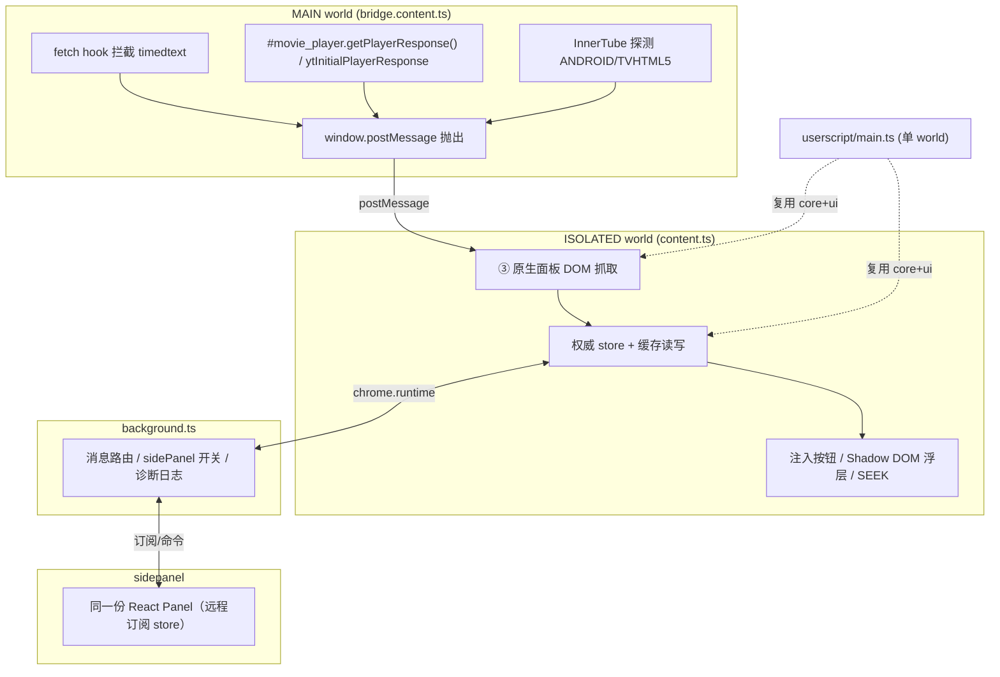

## 用户需求
把现有单文件油猴脚本（`user-script.js`，350 行，仅靠 DOM 抓取字幕 + 复制）升级为 **Chrome MV3 扩展 + Tampermonkey 脚本双平台**，并共享同一套核心代码；按用户给出的参考架构落地（MAIN/ISOLATED world 解耦、Side Panel 主界面、四层抓取兜底链、虚拟滚动、IndexedDB 缓存、失败分类日志）。

## 产品概述
一个常驻的 YouTube 字幕工作台：
- 视频页标题栏下方出现「Transcript」入口按钮，点击唤起字幕面板。
- 扩展端主界面为 Side Panel（常驻、跟随视频高亮），页面内浮层作为确定可用的兜底界面；油猴端主界面为页面右侧 Shadow DOM 浮层。
- 面板可搜索、逐行高亮、点击行跳转视频时间点、一键复制、导出 txt/md/srt/json。
- 切换视频（SPA 不刷新）自动重载；命中缓存秒开，不重复请求。

## 核心功能
1. **双端构建**：一条命令产出 `dist/extension/`（可加载已解压扩展）与 `dist/userscript/*.user.js`（单文件、带 meta 头），核心/UI 代码 100% 共用。
2. **四层抓取兜底**：① 被动拦截 YouTube 自带 timedtext 请求（借播放器的 POT 凭证）② playerResponse 的 captionTracks 取 baseUrl 主动 fetch（json3 → srv1）③ 打开原生 Show transcript 面板抓 DOM ④ InnerTube 探测（watch parse → ANDROID → TVHTML5）逐级降级；任一层成功即返回。
3. **失败分类**：EMPTY_200 / POT_ENFORCED / SELECTOR_MISS / RATE_LIMITED / AGE_RESTRICTED / NO_CAPTION_TRACK，界面上给出可读原因与重试/换策略入口，日志可导出排查。
4. **面板交互**：搜索过滤（命中计数 + 上下条跳转 + 关键词高亮）、时间戳开关、虚拟滚动（1000+ 行不卡）、当前播放行自动高亮并滚动跟随、点击行跳转播放、复制全文、导出文件。
5. **缓存与重初始化**：按 `videoId|lang|kind` 缓存 7 天；URL 变化（SPA 导航）重置状态并重新加载；面板打开时若无字幕轨道，明确提示「无字幕」而非「加载失败」。

## 视觉与体验
- 双端视觉一致：紧凑型工具面板，深色玻璃质感 + 中性灰层次，主色取 YouTube 邻近的高饱和红/橙作强调；行悬停/选中/播放中三态区分明显。
- 面板内不做原生弹窗；错误/空态用内联卡片（图标 + 一句话原因 + 操作按钮），不阻塞页面。
- 样式完全隔离（Shadow DOM + 作用域化 CSS），不污染也不被 YouTube 全局样式污染；跟随系统/YouTube 明暗主题切换。


## 技术栈
- 扩展框架：**WXT**（Chrome MV3，`@wxt-dev/module-react`）
- 语言：TypeScript（strict）
- UI：React + Tailwind CSS v4（`@tailwindcss/vite`）+ `@tanstack/react-virtual`
- 油猴打包：同一套 Vite + Tailwind 插件，独立 `vite.userscript.config.ts`，iife 单文件 + 手写 banner（无 `vite-plugin-monkey` 依赖）
- 存储/校验：原生 IndexedDB；Vitest 纯函数单测
- **不引入任何 GM_ API**（油猴保持 `@grant none`，脚本本身就在页面上下文运行）

关键前提（已核实）：WXT **没有** userscript 输出目标，只能产出扩展；社区做法即「WXT 构建扩展 + 独立脚本构建油猴包」。`chrome.sidePanel.open()` 仅允许 background/扩展页调用且需用户手势，content script 无该 API，点击→sendMessage→background 的异步链在实践中不可靠，**因此页面内浮层必须是确定可用的主界面，Side Panel 是增强面**。

## 实现方案

核心思路：把「抓字幕」做成**对 world 无感知的纯函数层**，把「UI + 状态」做成**对平台无感知的 React 层**，中间用两个接口（`Platform`、`TranscriptClient`）缝合。两端差异只在两个适配器文件里，其余全部复用。

- **扩展**：`bridge.content.ts`（MAIN，document_start）跑 ①②④ 并 `postMessage` 抛出；`content.ts`（ISOLATED）跑 ③、注入按钮、挂载浮层、执行 SEEK、向 Side Panel 转发状态；`background.ts` 做消息路由 / sidePanel 开关 / 缓存代理。
- **油猴**：单 world（页面上下文），直接跑 ①②③④ + UI，无需消息桥；仅「状态」通过进程内 `TranscriptClient` 实现直连。
- **抓取链**（`core/harvest/chain.ts`）：`②player+captionTracks → ④innertube`（并行，各自独立超时）→ `①拦截`（同时触发原生面板打开，等 2.5s 钩子事件，与 ③ 共享同一次「打开面板」动作）→ `③DOM 抓取`。任一层产出非空行即短路返回；每层失败写入对应 `ErrorCode`。
- **轨道选择**：`manual` 优先于 `asr`，语言按 用户偏好 → zh-Hans/zh → en → 首个可选轨道。
- **性能**：搜索索引只小写化一次并 memo；输入 120ms debounce；列表虚拟滚动只渲染可视行；当前行高亮用 `starts[]` 二分定位，避免每帧全表扫描。
- **安全/合规**：权限最小化（`storage`、`sidePanel`、`host_permissions: https://www.youtube.com/*`）；不使用远程代码；选择器远程覆盖仅限 JSON 且默认关闭；渲染字幕文本一律走 React 文本节点，不用 `innerHTML`。
- **兼容/风险控制**：根目录旧 `user-script.js` 完全不改动（老用户安装链接仍可用），新产物只写 `dist/`；hook 必须 clone 响应后再读、异常时原样返回，绝不打断 YouTube 自身请求；hook 用 Symbol 标记防重复安装。

### 架构图



## 实施要点
1. **selectors 与行为原样搬迁**：`SEL` 表、`pickPanel`（取片段最多者）、「面板已存在就绝不二次点击」、`segmentSelectorFor` 新旧元素互斥、`collapseDuplicates` 三个 aggressive 信号——这些是踩过坑的成果，重写会立刻复现重复字幕 bug。
2. **轮询工具统一**：`waitForElement` / `waitForSegments` / `sleep` 抽到 `core/dom/wait.ts`，content 与 userscript 共用。
3. **hook 只在 document_start 装**：晚装会漏掉播放器首帧请求；同时 patch `fetch` 与 `XMLHttpRequest`（二者都可能发 timedtext），只处理 URL 含 `/api/timedtext` 且 clone 副本解析失败时静默丢弃。
4. **消息协议要窄**：`{__ytt:1, type, payload}` + `event.source === window` 校验；类型仅 `READY / TIMEDTEXT / PLAYER / STATE / SEEK / OPEN_PANEL` 六种。
5. **UI 不 import CSS**：`Panel.tsx` 只出结构；Side Panel 用 `panel.css` + `<link>`，浮层用 `?inline` 注入 `<style>` 到 `shadowRoot`；Tailwind v4 关闭 preflight 或作用域化，避免 `:host` 冲突。
6. **SPA 重初始化**：扩展用 `ctx.addEventListener(window,'wxt:locationchange')`，油猴用 500ms href 轮询，统一走 `Platform.onLocationChange`；重建按钮时先移除旧节点（沿用现有 `copy-transcript-btn` id 判断）。
7. **可观测性**：`core/log.ts` 环形缓冲（最多 200 条）+ `ErrorCode` 分类；生产环境不打整段 payload，只打层名/耗时/行数，面板「诊断」可导出 JSON。

## 目录结构

```
youtube-transcript/
├── package.json                     # [NEW] 脚本：dev / build:ext / build:userscript / build / test / zip
├── wxt.config.ts                    # [NEW] MV3、react 模块、permissions(storage,sidePanel)、host_permissions、content_scripts 顺序
├── vite.userscript.config.ts        # [NEW] iife 单文件 + 手写 TM meta banner（name/version/match/run-at/noframes/grant none）
├── tsconfig.json / vitest.config.ts / .gitignore   # [NEW] strict TS；node 环境跑 core 纯函数；忽略 dist/.output/.wxt
├── entrypoints/
│   ├── bridge.content.ts            # [NEW] world:'MAIN', runAt:'document-start'：装 hook、读 playerResponse、InnerTube 探测、postMessage 抛出；含防重复安装
│   ├── content.ts                   # [NEW] ISOLATED：接收 bridge 消息、跑 ③DOM、持有权威 store、注入按钮 + 浮层、SEEK、与 background/sidepanel 通信、SPA 重初始化
│   ├── background.ts                # [NEW] chrome.action.onClicked、sidePanel.setPanelBehavior、OPEN_PANEL/缓存读写/诊断转发的消息路由
│   └── sidepanel/                   # [NEW] index.html + main.tsx：挂载共享 Panel + 注入 panel.css + 远程 TranscriptClient
├── src/core/                        # 平台无关：禁止 import chrome.* / React / 全局 window 直取
│   ├── types.ts                     # [NEW] TranscriptLine / CaptionTrack / HarvestResult / ErrorCode / SourceName
│   ├── log.ts                       # [NEW] ErrorCode 分类 + 环形日志 + 耗时记录
│   ├── store.ts                     # [NEW] 可变 store（subscribe/getState/patch），承载 status/lines/search/activeIndex
│   ├── harvest/
│   │   ├── chain.ts                 # [NEW] 按序跑 sources、短路、逐层记录失败码、总超时控制
│   │   ├── intercept.ts             # [NEW] 可移植 fetch/XHR hook 安装器（传入 win），仅匹配 timedtext，clone 读取，异常静默
│   │   ├── player.ts                # [NEW] readPlayerResponse(win)（movie_player → ytInitialPlayerResponse → ytcfg）、提取 captionTracks 与 InnerTube key/version
│   │   ├── timedtext.ts             # [NEW] baseUrl 拼 fmt=json3/srv1、状态码与空 body 判定（EMPTY_200/POT_ENFORCED/RATE_LIMITED/AGE_RESTRICTED）
│   │   ├── innertube.ts             # [NEW] watch page parse → ANDROID → TVHTML5 逐级降级，返回 track 列表
│   │   └── parse/{json3,srv1,vtt}.ts# [NEW] 三种格式 → TranscriptLine[]，统一四舍五入到 ms、去重、空行过滤
│   ├── dom/
│   │   ├── selectors.ts             # [NEW] 现有 SEL 表 + 可选远程 JSON 覆盖（默认关闭）
│   │   ├── wait.ts                  # [NEW] sleep / waitForElement / waitForSegments / isVisible
│   │   ├── panel.ts                 # [NEW] countSegments / pickPanel / openTranscriptPanel（绝不二次点击）
│   │   ├── scrape.ts                # [NEW] collectFromList / extractTranscript / extractFallback / normalizeLines
│   │   └── dedupe.ts                # [NEW] collapseDuplicates（原样搬迁）
│   ├── format/export.ts             # [NEW] txt / md / srt / json 生成 + 时间戳开关 + 文件名 slug
│   └── cache/index.ts               # [NEW] 原生 IndexedDB：transcripts(key=videoId|lang|kind, TTL 7d) + events(诊断)
├── src/platform/
│   ├── types.ts                     # [NEW] Platform（openPanel/onLocationChange/seek/clipboard/download）与 TranscriptClient（getState/subscribe/dispatch）
│   ├── extension.ts                 # [NEW] chrome.runtime/sidePanel/storage 实现；OPEN_PANEL 1s 超时回落浮层
│   └── userscript.ts                # [NEW] 进程内实现：直连 store、浮层开关、Shadow DOM 挂载
├── src/ui/
│   ├── Panel.tsx                    # [NEW] 组合布局：Header + Toolbar + List + 状态区；只依赖 TranscriptClient
│   ├── Toolbar.tsx                  # [NEW] 搜索框、命中计数、上下条、时间戳开关、复制、导出菜单
│   ├── TranscriptList.tsx           # [NEW] react-virtual 虚拟滚动、三态样式、点击 seek、当前行自动跟随
│   ├── EmptyState.tsx               # [NEW] 空/错误卡片：ErrorCode → 文案 + 重试 + 换策略
│   ├── useTranscript.ts             # [NEW] 订阅 client 状态、搜索 memo + debounce、二分定位当前行
│   └── styles.css                   # [NEW] Tailwind 入口（供两端通入，Panel 自身不 import）
├── userscript/main.ts               # [NEW] 油猴入口：装 hook → 组装 core 链 + store → 按钮 + Shadow 浮层 + SPA 重初始化
├── scripts/gen-icons.mjs            # [NEW] 零依赖生成 16/32/48/128 PNG 图标
├── tests/                           # [NEW] chain 降级顺序/错误分类、json3/srv1/vtt 解析、dedupe、export 格式
├── user-script.js                   # [KEEP] 旧版脚本原样保留，不维护不改动
└── README.md                        # [MODIFY] 双端安装/开发/构建/架构与排错说明
```

## 关键接口

```ts
export type ErrorCode =
  | 'NO_CAPTION_TRACK' | 'EMPTY_200' | 'POT_ENFORCED' | 'SELECTOR_MISS'
  | 'RATE_LIMITED' | 'AGE_RESTRICTED' | 'NETWORK_ERROR' | 'UNKNOWN';

export interface HarvestResult {
  lines: TranscriptLine[];
  source: 'intercept' | 'player' | 'innertube' | 'dom';
  track?: CaptionTrack;
  showTimestamps: boolean;
  failures: Array<{ source: string; code: ErrorCode; ms: number }>;
}

/** core 只认注入进来的依赖，不碰全局 chrome / 不假定 world */
export interface HarvestContext {
  win: Window;
  videoId: string;
  signal: AbortSignal;
  preferredLangs: string[];
  log: (code: ErrorCode, meta?: Record<string, unknown>) => void;
}

/** UI 只依赖此接口；扩展=消息实现，油猴=进程内实现 */
export interface TranscriptClient {
  getState(): PanelState;
  subscribe(fn: (s: PanelState) => void): () => void;
  load(force?: boolean): Promise<void>;
  seek(seconds: number): void;
}
```


## 设计定位
「安静的效率工具」：像 Linear / Raycast 那样的紧凑信息面板，而不是营销页。字幕是主体，所有控件退到一条常驻工具栏里，视觉重量集中在文本行与当前播放行上。双端同一套组件；浮层为右侧贴边卡片（宽 380px，圆角 14px，浮起 + 细边），Side Panel 为满高无圆角版本。

## 布局与区块
1. **Header（48px）**：视频标题（单行省略）+ 语言/轨道徽标 + 关闭/收起。下方 1px 分隔线，滚动时保持吸顶。
2. **Toolbar（52px）**：搜索输入（放大镜 + 快捷键提示 ⌘K）、命中计数「12/138」与上下条箭头、时间戳开关（Switch）、复制、导出下拉（txt/md/srt/json）。控件 hover 才显形，避免常驻噪声。
3. **List（主体）**：虚拟滚动行，行高自适应 2 行文本；左侧 3px 竖直强调条表示播放中；时间戳等宽小字、hover 显示并有 2px 位移反馈；搜索关键词用暖色底高亮。播放中行自动滚动跟随，但用户手动滚动后 3s 内不抢焦点。
4. **Footer/Status（32px）**：来源标记（拦截 / 播放器 / DOM / InnerTube）、行数、缓存命中标记、诊断入口。
5. **状态区（覆盖 List）**：加载骨架行（3 条灰条 shimmer）、无字幕、被拦截（POT）、限流、选择器失效——每种一张内联卡片（图标 + 一句原因 + 主按钮「重试」/「换策略」）。

## 交互与动效
- 打开：浮层从右侧 12px 滑入 + 淡入（180ms cubic-bezier(.2,.8,.2,1)），关闭反向；同一时刻只存在一个实例。
- 悬停行：背景由 transparent → 6% 白，时间戳自 40% 透明度升至 100%。
- 点击行：视频跳转，行内 300ms 高亮脉冲（强调色 12% 填充消退）。
- 播放跟随：滚动使用 `behavior:'smooth'`，节流 200ms。
- 复制：按钮文案切「Copied」+ 对勾，1.5s 复位。
- 全部动效尊重 `prefers-reduced-motion`。

## 响应式
- 宽度 < 480px（窄窗口/Side Panel 最小宽）时：工具栏折叠为图标，导出入「⋯」菜单，时间戳列可隐藏。
- 高度自适应，List 使用 flex-1 + 虚拟滚动，绝不让整页出现滚动条。
- 高对比度模式（`prefers-contrast: more`）下边框与文字对比度提升，强调条加粗。

## 明暗主题
跟随 `prefers-color-scheme`，并提供面板内三态切换（跟随/浅/深），存于 storage；深色为默认主推视觉。

