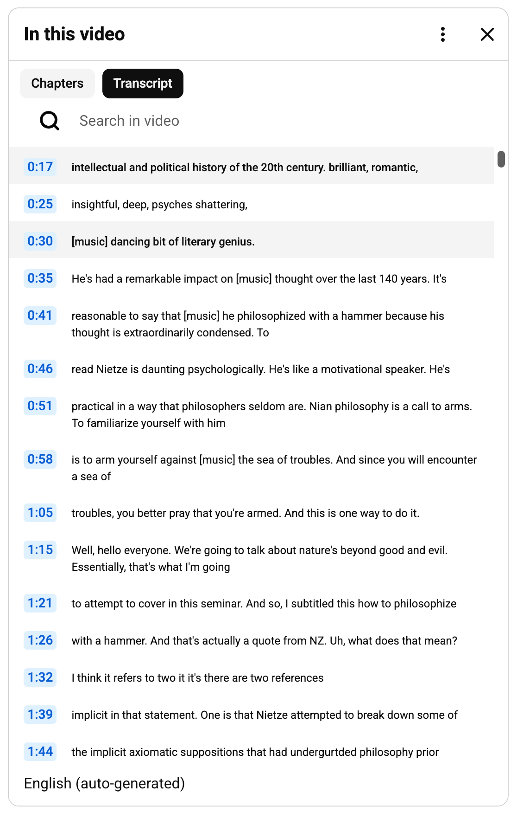

# YouTube Transcript Studio

一个常驻的 YouTube 字幕工作台，同时产出 **Chrome MV3 扩展** 与 **Tampermonkey 脚本**，两端共享同一套核心代码与 UI。



- 页面标题栏出现 `Transcript` 入口，点开是**嵌进观看页右栏的卡片**（相关视频上方，随页面滚动，不遮挡视频）；无右栏的页面只给按钮提示。扩展仍可用工具栏开 Side Panel
- 切到另一个视频时面板不关，自动换成当前视频的字幕与章节；不会残留上一个视频的内容（判据是**内容指纹**，见下文「切页」）
- 标题栏第二行只在**抓取中**（显示当前阶段）和**抓取失败**时出现；抓成功后整行隐藏 —— 来源与行数底栏已经写了，不再重复
- **字幕语言可选**：工具栏 `中` / `EN` 两个按钮（有对应字幕才出现），都不选中 = 同音频（不翻译，用视频自己的轨道）
- 字幕支持搜索 / 命中计数 / 上下条跳转 / 关键词高亮
- 点击任意行跳转视频时间点，播放时自动高亮并滚动跟随
- 排版学 YouTube 原生面板：`Roboto, Arial, sans-serif`、正文 **14px / 行高 24px**；时间戳**单独占一行**（12px 灰、在正文上方），左右各 20px 留白，块与块之间约 22px
- 复制全文，或导出 `txt` / `md` / `srt` / `json`
- 完整结构化字幕源优先的抓取兜底链 + 失败分类，抓一次缓存 7 天
- ASR 碎片按句子合并成段落（和 YouTube 原生面板一样的粒度），显示 / 搜索 / 复制 / 导出共用同一份

## 一个产物，一个入口

页面上只有**一个**按钮 `Transcript`（`ytt-entry-btn`），点开是右栏卡片。卡片固定高度、
不可收起 —— 右栏本来就窄，收成一条标题栏既省不下多少地方，又容易和「关闭」混淆。

> **1.x 原版实现已彻底移除**（v2.23.0）。早期为了「先能跑」把旧脚本整份搬进产物，
> 新版通过一个全局对象调它的提取函数；旧 UI 早已退役、能力也全部由 TS 承接，
> 于是脚本本体、构建期同步脚本、转发层和空目录一并删除。
> **现在生成物里不含任何旧实现的代码、标识或全局变量。**
>
> 能力去向：

| 原版能力 | 现在的实现 |
| --- | --- |
| `openTranscriptPanel` / `pickPanel` / `countSegments` | `src/core/dom/panel.ts` |
| `extractTranscript` / `collectFromList` | `src/core/dom/scrape.ts` |
| `extractFallback`（按时间码切 `innerText`） | `src/core/dom/text-rows.ts` |
| `stripA11yDuration`（无障碍时长清洗） | `src/core/format/a11y.ts` |
| `parseChapters` / `readChapterRows` | `src/core/format/chapters.ts` |
| `formatCopyText` | `src/core/format/copy.ts` |

产物因此少了约 7 kB（userscript 112 kB → 105 kB），构建也不再需要前置同步脚本。

### DOM 预览：一次同步只读，不点击、不轮询、不滚动

字幕列表是**虚拟列表**：只渲染视口附近的行，还会跟着播放进度自动滚到当前位置。
以前靠「点开原生面板 → 12 轮轮询 → 从头滚到底」凑字幕，既慢又会漏掉前段；
那份残缺结果一旦写进缓存，7 天里都显示不全，只能靠「清空缓存并重新抓取」恢复。

现在 DOM 层只负责**临时预览**：

- `readDomPreview(doc, { videoId, skipSnapshot, avoidSignature })` 一次同步扫描
  `body.innerText`（`quick: true`，不遍历整页候选元素），按行首时间码切行，
  取「时间戳最长递增段」；**一个按钮都不点、一个定时器都不起**
- 归属闸门：`videoId`（播放器还停在别的视频就放弃）、`avoidSignature`
  （与上一条视频内容完全一致就丢弃）、`skipSnapshot`（刚切页时不信页面现有文字）
- 预览经 `onPreview` 回传给会话层临时显示，`complete: false`，**不写缓存、
  不短路完整源**；`get_transcript` 的完整结果到达后直接覆盖它
- 快照只取**可见文本**，不用 `body.textContent` —— 后者会把 ytInitialData 里的
  章节 JSON 带进来，切出 `28:14 ] — Rethinking…` 这种假字幕
- 时间戳最长递增段要求相邻间隔 ≤ 45 秒、至少 3 行、行内无 JSON 残留

完整字幕由下面「抓取兜底链」的结构化源负责，不再依赖虚拟列表渲染了多少行。

### 复制 / 章节 / 时间戳：只有一份实现

`src/core/format/` 是唯一实现，面板、导出、搜索共用，不存在「两套规则对不上」：

- **干净文本**：YouTube 给每个时间点配了一段无障碍复述（`33:26 33 minutes, 26 seconds`、
  `3:323 minutes, 32 secondsI don't…` 这种粘连），`stripA11yDuration()` 会去掉它。
  判据是**数值必须和时间码完全一致**，所以 `1:23 we waited 5 minutes` 这种真实台词不动。
  清洗在进 state 前做一次（显示/搜索/复制/导出同一份），复制时再按行起点兜一次
- **时间戳开关**：工具栏时钟按钮 = `prefs.timestamps`，同时控制显示与复制
- **chapters**：`readChapterRows()` 只认章节面板
  （`target-id*="chapter"` / `*="macro-markers"`、`ytd-macro-markers-list-item-renderer`），
  按 30 秒间隔抽样；**绝不能加 `[visibility*="EXPANDED"]`** —— 那正是字幕面板，
  字幕行按 30s 抽样后会凑出十几行，把字幕误判成章节。章节独立存在 `PanelState.chapters`，
  不参与 `looksLikeTranscript()` 校验；抓取失败时章节照样能看、能复制
- **视图切换**：工具栏「字幕 / 章节」按钮切换 `prefs.view`；可切换时复制、导出（`-chapters.txt`）、
  搜索、播放高亮全部跟着换数据源。当前视频没有章节时自动回退到字幕视图
- **点击时间点**：`TranscriptLine.start` 是毫秒，`video.currentTime` 是秒，
  `row.ts` 里换算后再 seek（之前直接传毫秒，`1:05` 会跳到 65000 秒）


### 章节截图 / 高亮 / 开关即时生效

**章节截图**来自 YouTube 的 storyboard 雪碧图（`playerResponse.storyboards.playerStoryboardSpecRenderer.spec`），
按时间点裁切，不额外发请求：

- 规格串 `URL|帧宽#帧高#总帧数#列#行#帧间隔ms#图集名#签名`，URL 里 `$L` = 档位、`$N` = 图集名
- **每档 URL 必须拼回该档自己的 `?sigh=`（第 8 个字段）**。少了它 `i.ytimg.com` 直接
  401/404，表现就是「章节截图全是空白」——这是最容易漏、也最难从代码上看出来的一步
- `$L` 用**原始段序号**（0 起），解析失败的段不参与取帧但不能让后面的档位下标回退；
  与 YouTube.js 的 `PlayerStoryboardSpec` 一致
- 跳过 `间隔=0` 的档位（那是整段海报，无法按时间定位）
- 宽、高、偏移**必须共用同一个 scale**：`56/80*45 = 31.5`，四舍五入成 32 会让裁切漏出下一行
- 只在章节视图渲染；字幕视图几千行，逐行拉图没有意义
- 扩展的 content script 在 isolated world 读不到 `playerResponse`，走 `STORYBOARD` 桥到 MAIN world；
  油猴本身在页面上下文，直接读。取不到就不显示，不影响章节本身

**章节高亮**必须用真实播放位置 `positionMs`：

```ts
// 错的：state.lines[activeIndex].start 是字幕行起点，早于章节起点
// 章节 28:14 对应的字幕行可能是 28:09 → 永远高亮上一章
findChapterIndex(chapters, state.positionMs);
```

`timeupdate` 只把 `positionMs` 按秒取整写入（无章节时不写，避免白白多渲染），
`seek()` 立刻写入，所以点章节的瞬间高亮就跳到目标，不用等下一个 `timeupdate`。

**时间戳开关不生效**的根因在虚拟列表：开关改变行结构但不改变行数，
而 `setCount()` 在数量相同时直接 `return`，已挂载的行永远不会重建。
新增 `refresh()` 强制重渲染并保留滚动位置，面板比较行数后择一调用。

### 验收

`tests/copy-shared.test.ts` 覆盖时间码切行、无障碍时长清洗、章节解析与复制格式化；
`tests/chapters.test.ts` 用整页可见文本断言「章节时间点不会被当成字幕」。
`npm run build` = `clean → icons → build:ext → build:userscript`：**先清空 `dist`/`.output` 再产出**，
所以不会出现旧哈希 chunk 与新产物并存的情况。没有构建期同步步骤。

页面上只有 `ytt-entry-btn` 这一个入口；`removeEntryButton()` 也只删它。

> `dom` 层（`native-panel.ts`）的两处适配：面板若在 shadow root 里，用 `deepQueryAll` 重新发现；
> 失败时把逐层诊断（哪一层、为什么被丢弃、面板是否重建）写进诊断文本，点底栏「诊断」即可查看。
>
> 能读到 2026 版 "In this video" 框里的字幕，靠的是按时间码切 `innerText`：
> 片段标签一个都匹配不到时，它直接把 `panel.innerText` 按时间码切分。
> 它**不要求面板里已经有片段元素**。之前的新版实现加了「面板必须有片段」这个条件，
> 把那个能产出文本的面板丢掉了 —— 这是「原版能行、新版不行」的分歧点。

## 安装

### Chrome 扩展

```bash
npm install
npm run build:ext
```

打开 `chrome://extensions` → 开启「开发者模式」→「加载已解压的扩展程序」→ 选择 `dist/extension`。

点工具栏图标打开 Side Panel；页面上的 `Transcript` 按钮打开的是**右栏内嵌卡片**，不再尝试 Side Panel（工具栏那条路径保持不变）。

没有右栏的页面（Shorts、极窄布局）不显示面板，按钮会短暂提示「当前页面没有右栏」并复原，不弹阻塞对话框。

### Tampermonkey 脚本

```bash
npm run build:userscript
```

把 `dist/userscript/youtube-transcript.user.js` 拖进 Tampermonkey 的安装页（或直接打开该文件）。脚本 `@grant none`，本身运行在页面上下文，不需要任何 GM_ API。

## 开发

```bash
npm run dev              # WXT 开发模式（改组件会整页重载，见下方说明）
npm run dev:userscript   # 油猴产物 watch 构建
npm run build            # 图标 + 扩展 + 油猴 一起构建
npm run typecheck        # tsc --noEmit
npm test                 # vitest：解析器 / 兜底链 / 导出 / DOM 纯函数
npm run zip              # 打包扩展 zip
```

> **UI 层是原生 TypeScript，没有任何框架运行时。** 面板用 `document.createElement` + 一套 8 个文件的迷你组件（`dom.ts` / `virtual-list.ts` / `toolbar.ts` / `panel.ts` …）构建，图标是内联 SVG，滚动是手写的窗口化实现。`package.json` 的 `dependencies` 为空，所有依赖都在 devDependencies（构建期）。代价是改 UI 要自己管 DOM 更新时机；收益是产物从 328 KB 降到 72 KB（gzip 102 → 24 KB），且不受任何框架升级影响。

## 架构

核心思路：**抓取层对 world 无感知，UI 层对平台无感知**，两端差异只落在各自的入口与适配器里。

```
entrypoints/                 扩展端（Chrome MV3）
├── bridge.content.ts        MAIN world：① 被动拦截 ② playerResponse ④ InnerTube
├── content.ts               ISOLATED：③ 原生面板 DOM 抓取、入口按钮、右栏卡片、SEEK
├── background.ts            工具栏点击开侧栏 + 消息路由
└── sidepanel/               Side Panel（同一份 Panel 组件）
userscript/main.ts           油猴单 world：①②③④ + UI 全在一个进程
src/core/                    平台无关：抓取链、解析、缓存、导出、store
src/platform/                session / bridge RPC / local+remote client
src/ui/                      面板组件（双端同一份，原生 DOM）
  dom.ts                      el() 构造器、显隐、二分查找等基础件
  panel.ts                   面板骨架 + 状态派发 + 播放跟随
  toolbar.ts                 两行工具栏：搜索+跳转 / 视图+语言+时间戳+复制+导出
  virtual-list.ts            可变行高窗口化滚动（实测行高回填）
  sidebar.ts                 右栏内嵌：挂载点解析、Shadow 卡片、被重建后自动重挂
  sidepanel.ts               唯一剩下的第二种挂载点（扩展侧栏文档）
```

产物体积（生产 + minify）：油猴单文件 73 KB / gzip 24 KB；扩展 content script 68 KB、侧栏 chunk 27 KB、CSS 23 KB。对比 1.x 的 14 KB 单文件，多出来的部分是兜底链、解析器、导出、IndexedDB 缓存与整个面板 UI。

### 为什么这样拆

- **扩展必须拆 world**：`#movie_player.getPlayerResponse()`、`ytInitialPlayerResponse`、`fetch` hook 都只能从页面 JS 上下文（MAIN world）拿到；而 `chrome.runtime`、侧栏、Shadow DOM 挂载在 ISOLATED world。两者用 `window.postMessage` 上的窄协议 RPC 通信。
- **油猴不需要拆**：`@grant none` 的脚本本身就跑在页面上下文，于是 `core/harvest/sources.ts` 里那三个源函数直接原地调用。**core 的每一层只接收传入的 `window`，绝不直接引用全局** —— 这就是「共享核心」成立的前提。
- **Side Panel 不能直接操作视频**：所有 `load` / `seek` 都走消息；油猴端是同一个进程内的 `TranscriptClient` 实现。

### 抓取兜底链

**完整结构化源优先，DOM 只做同步预览**。任一层拿到非空行即短路返回：

| 顺序 | 层 | 说明 |
| --- | --- | --- |
| ⓪（仅要翻译时） | `remote` | `preferRemote`：远程层是唯一能产出目标语言的层，先问它，避免「切中文显示英文」 |
| ⓪.5 | `cachedIntercept` | 此前已截获的完整 `get_transcript` / `timedtext` 响应，0ms 命中 |
| ① | `domPreview` | 同步预览，**不短路**：只让屏幕上先有字，`complete: false` |
| ② | `structured` | 主路径：直接构造 InnerTube `get_transcript` 请求，一次拿回**全部分段**与精确 `startMs/endMs`。页面自带 params 优先；带 6s 上限与尝试次数上限 |
| ③ | `intercept` | 等 YouTube 自己发出的字幕响应（短等 2.5s） |
| ④ | `remote` | `playerResponse.captionTracks` → `/youtubei/v1/player` 降级探测 |

`get_transcript` 就是 YouTube 原生字幕面板的数据源：它一次返回全部分段，
不依赖虚拟列表渲染了多少行，也不依赖播放器就绪。所以主路径既**快**又**完整**，
最坏等待从「12s 等播放器 + 10s 等切页 + 12 轮轮询 + 60 屏滚动」收敛为
「一次短网络请求 + 一次线性合并」。所有完整源都失败时进入错误态并清空预览，
绝不把缺前段的内容当成成功结果。

> **不再主动打开原生面板**。常规路径完全不点 `Show transcript`，因此页面上不会
> 因为我们多出一块 YouTube 字幕面板。若页面上残留着旧版本留下（或用户自己点开）的面板，
> `chain.ts` 的 `finally` 会 `await closeTranscriptPanelVerified(document)`：
> 「点一下 → 等 220ms → 再看是否仍展开」，最多三轮，确实收起了才算完成。
> 只点 YouTube 自己的按钮，不隐藏/移除它的节点。

### 切页（SPA）为什么以前会显示上一个视频的字幕

点「相关视频」跳到另一个视频时，YouTube 只换 DOM 不换进程，于是有几段时间窗口会读到旧数据。

分两类：**状态压根没换**（整个面板含标题都停在旧视频）和 **状态换了但内容来自旧视频**。

#### 一、状态没换（标题也不变 —— 说明不是抓取问题）

标题直接来自 `document.title`，与抓取链无关。标题也停在旧视频，只能是「面板状态从未切换」。

| 环节 | 现象 | 现在怎么做 |
| --- | --- | --- |
| 一次异常就永久失效 | `tick()` 先 `lastUrl = location.href` 再干活；`sidebar.ensureMounted()` 抛一次异常就跳过本次 `sync()`，而 URL 已被记成「处理过」，之后每次 tick 都在第一行 return | `lastUrl` 挪到**全部干完之后**才更新；每步独立 `try/catch` |
| 只靠事件驱动 | `session.sync()` 只在被调用时推进，漏一次就永久错 | 新增 **500ms `reconcile()` 自愈循环**（`session.start()`）：只比对「地址栏 ?v=」与「store.videoId」，不一致就 abort + 清空 + 重抓；回调整体 `try/catch`，异常绝不外溢 |
| 宿主重建后面板不重挂 | `ensurePanel()` 见到 `panel` 就 return，新 shadow root 是空的，面板还留在旧的（已脱离）root 里 | 判定 `panel.element.parentNode !== shadowRoot` 就重新 append 并 `relayout()`；同时清理重复的 `#ytt-sidebar-host` |
| 标题可能来自旧玩家响应 | `readTitle` 只读 `document.title` | `readTitleFor(win, videoId)`：`playerResponse.videoDetails.videoId` 对得上才用它，否则退回 `document.title` |

#### 二、状态换了但内容来自旧视频

| 环节 | 现象 | 现在怎么做 |
| --- | --- | --- |
| 地址栏先变、播放器后变 | 播放器还停在旧视频，DOM 里仍是旧字幕行 | `readDomPreview()` 里的 `staleVideoNote(doc, videoId)` 直接放弃预览；完整结果来自结构化源，不依赖播放器就绪 |
| **原生面板不销毁** | YouTube 切页不会关掉展开着的字幕面板，里面还是上一个视频的行；**这些行没有任何 videoId 标记** | ①`reconcile()` 里 `closeTranscriptPanelVerified()` 验证式收起（最多三轮）；②切页那一刻记下**旧内容指纹**（`contentSignature`），预览前比对，与上一条完全一致就丢弃 |
| 预览没有归属信息 | `snapshotTranscriptText` 只认文字，不认是谁的 | `readDomPreview(doc, { videoId, skipSnapshot, avoidSignature })` 三道闸门一起判；而且预览**不进缓存、不当最终结果**，最坏也只闪一下就被完整字幕覆盖 |
| 播放器响应滞后 | `playerResponse` 还挂着上一个视频，用它取 `captionTracks` 会拉到**上一页**的 timedtext；storyboard 同理 | `sources.ts` 校验 `playerResponse.videoDetails.videoId`，不匹配就不取轨道（改走 innertube 探测）；`readStoryboardSpec(win, videoId)` 同样校验 |
| 拦截层归属错标 | `get_transcript` 的 videoId 用地址栏猜，切页时会把旧视频的响应当成新视频 | 先读 **POST body 的 base64(protobuf) `params`**（`0x0a 0x0b <11 字节 id>`），读不到再退**请求发出那一刻的播放器 id**，最后才是地址栏；归属为 `null` 的捕获不命中任何 `waitFor` |

#### 三、最后一道闸门：可见即正确

即使前面全部失效，界面也不会显示错的内容。`panel.ts` 的 `render()` 每次都会比对「面板状态的 videoId」与「地址栏当前 videoId」：

- 不一致 → 标题变「正在切换到新视频…」，列表清空只留骨架，复制/导出按钮禁用；
- 侧栏 600ms 轮询发现地址栏视频变了就 `panel.refresh()`，不依赖 store 通知。

所以最坏情况下看到的是「同步中」，而不是上一个视频的字幕。

章节也走同一套判断：切页瞬间 `sync()` 直接清空章节，等 videoId 对齐后再从页面重新读取（`readChaptersIfCurrent`）。

### 字幕语言（中 / EN 两个按钮）

工具栏上是**两个独立按钮**：`中` 和 `EN`。

- **都不选中 = 同音频**（默认）：不翻译，用视频自己的字幕轨道（通常是 ASR 原声）。
- 选中某个语言就切过去；**再点一次已选中的按钮**回到同音频。

**只有视频确实自带该语言字幕时，对应按钮才可点。** 判据是 `readAvailableLangs(win)`：

```
availableLangs = 原生 captionTracks 的语言      ← 只有这个
```

- 原生中文轨道有 → `中` 可点；没有 → `中` **置灰**，悬停提示「这个视频没有中文字幕」；
- 中/英都没有（例如只有日文字幕、或视频无字幕）→ **整组隐藏**；
- `playerResponse.videoDetails.videoId` 对不上当前页时返回空数组，避免切页瞬间拿上一个视频的轨道去建按钮。

> 早先这里把 `translationLanguages`（YouTube 声称能机翻到的语言）也算进可用性，
> 结果按钮显示可点、点下去却拿不到中文——`tlang` 请求被签名/POT 挡掉，或服务端
> 直接忽略 `tlang` 返回原声轨道。对用户来说就是「按钮是假的」。
> 现在只报**能保证拿到**的语言：视频自带的轨道。

按钮状态与抓取行为必须一致：偏好是全局记住的，换了条视频可能给不了你选的语言，
这时 `pickUsableChoice()` 会退回「同音频」，按钮也显示为未选中 —— 不会出现
「按钮没选中、实际却在请求翻译」这种对不上的情况。

这份可用语言由 session 在 `reconcile()` 里每 500ms 校正一次（`playerResponse` 通常比地址栏晚一步就绪），写进 `PanelState.availableLangs`，面板据此渲染。

解析规则（`src/core/langs.ts` 的 `resolveLangPlan`）：

| 选择 | 轨道偏好顺序 | 是否翻译 |
| --- | --- | --- |
| 同音频 | 浏览器语言 → zh → en | 否 |
| 中文 | `zh-Hans` → `zh-Hant` → `zh` → `zh-CN` → `zh-TW` | 否（按钮只在有原生中文时可点） |
| English | `en` | 否（按钮只在有原生英文时可点） |

`tlang` 机翻的代码仍保留在 `tryTrack` 里（选中的轨道确实不匹配目标语言时才会拼上），
但 UI 不会再引导用户走到那条路——它能否成功取决于视频与 YouTube 的签名策略，无法保证。

**只要视频本身有该语言的原生字幕，就用原生的**（质量比机器翻译好）；没有才把 `&tlang=` 拼到 timedtext URL 上让 YouTube 机翻。

几个配套细节：

- 切语言会**强制重抓**（`load(true)`）并先清空旧行，不会让你盯着英文界面以为切失败；
- **要翻译时必须让远程层先上**。被动拦截层、结构化源和 DOM 预览只能给视频原文，如果先命中就会出现「切回中文却显示英文」而状态还是 ready。所以 `harvestTranscript` 收到 `preferRemote` 时会先把远程层提上来，同时拦截层也会拒绝语言不符的捕获（`capture.lang !== tlang`），结构化源在 `plan.tlang` 存在时直接跳过（不拿原文顶替）；
- 缓存按语言分开存（`cacheKey` 里含语言），读的时候也按目标语言过滤，所以「切中文」不会命中上次的英文；
- 拦截层（`get_transcript`）和结构化源拿到的永远是**视频原声语言**，没法翻译。这两层命中时，底栏显示的语言徽标会是实际语言（例如 `EN`），和按钮上的选择不一致就说明「这条视频没有你要的语言，显示的是原文」。

### 缓存语义（会不会串视频）

**按 videoId 建键不会串**，但**内容可能被写错**——这是 v2.20.2 之后才查清的一个坑：

早期版本在 SPA 切页窗口期抓到的是**上一个视频**的 DOM 字幕，却按**新视频**的 `videoId` 写进了缓存。这种条目：

```
videoId   B  ✓ 与当前页一致
内容      却是 A 的字幕  ✗
```

`readCacheForVideo` 按 videoId 过滤，所以永远命中它；面板新鲜度闸门比 id，也永远通过。结果是那条视频打开就显示别人的字幕，且持续 7 天——「把很早以前的字幕拿出来」就是这么来的。

四道防线：

1. **整体作废**：`CACHE_SCHEMA` 抬到 **8**，旧条目全部失效（键前缀变了）。v6 清的是 DOM 串页写坏的条目，v7 清的是拦截层归属错误写坏的条目，**v8 清的是「只含视口几十行」的残缺 DOM 结果** —— 那正是「点清空缓存并重新抓取才拿到全部字幕」的原因。
2. **完整性标记** `SourceOutcome.complete` / `CachedTranscript.complete`：DOM 预览 `complete: false`，`writeCache()` 直接拒写，`readCacheForVideo()` 也只返回 `complete !== false` 的条目。缓存里存的是**清洗后的原始分段**，展示时才做句子合并，避免命中缓存时二次合并把行越粘越长。
3. **写入守卫** `writeCache(entry, { playerVideoId })`：抓取当时播放器不在 `entry.videoId` 上就拒绝写入。
4. **读取时做物理一致性校验**：`transcriptFitsDuration(lines, duration)` —— 字幕最后一条不可能晚于视频结束（留 60s 容差）。这条判据与 videoId 无关，所以能揪出「id 对、内容错」的条目，命中即删除并改为现抓。

底栏「诊断」里能直接看到**当前页面 / 面板所属**两个 videoId 以及**这次是缓存命中还是现抓**，底部有「清空缓存并重新抓取」按钮（现在正常情况下不再需要它）。

### 失败分类

`EMPTY_200` / `POT_ENFORCED` / `RATE_LIMITED` / `AGE_RESTRICTED` / `NO_CAPTION_TRACK` / `SELECTOR_MISS` / `NETWORK_ERROR` / `UNKNOWN`

每层失败都写入 `failures[]`，面板底栏「诊断 N」可以展开看每一层的错误码与耗时——排查时先看这个，再决定是重试还是等更新。

最终展示的错误码取**最后一层**的分类：结构化源没轨道报 `NO_CAPTION_TRACK`（视频没字幕），拦截超时报 `EMPTY_200`，远程被限流报 `RATE_LIMITED` —— 这些情况的处理方式完全不同。DOM 预览不产生最终结果，因此不再有 `SELECTOR_MISS` 误报。

> 2025 年中之后 YouTube 对 WEB client 的 timedtext 加了 proof-of-origin token，裸请求会返回 `HTTP 200 + 空 body`。空 body 不等于「没有字幕」，`captionTracks` 是否存在才是判断依据。

> 另一种 200 陷阱：**人机校验页**（"…may be sending automated queries…"）。它是 `HTTP 200 + HTML`，
> `parseSrv` 的 `<p>` 兜底会把它当成「一条字幕」显示出来，看起来和真字幕没区别。
> 现在 `isBlockedPayload()` 会在解析前拦掉，并按 `RATE_LIMITED` 记失败，让兜底链继续往下走。

### 缓存

`IndexedDB`（库名 `ytt-cache`），key = `v8|videoId|lang|kind`，TTL 7 天；同一视频切来切去不会重复请求，降低被限流概率。只缓存完整结构化结果。

### 句子合并

`get_transcript` 返回的是 2–4 秒一段的 ASR 碎片，YouTube 原生面板会把连续几段合成一条、只在段落开头留一个时间码。我们以前把每个 segment 单独渲染成一行，同一份数据看起来「特别散」。

`mergeFragments()`（`src/core/lines.ts`）做一次线性遍历补上这一步：相邻间隔 ≤ 8s、合并后 ≤ 140 字符、跨度 ≤ 12s 才合并；`[CHEERING, APPLAUSE]` 这类舞台提示独立成行；中文边界不加空格、英文边界补空格；保留首段 `start`（点击跳转 / 播放高亮靠它），并把 `dur` 重算成「末段结束 − 首段开始」（SRT 导出靠它，否则段落会被截短）。

## 加一层新抓取

1. 在 `src/core/harvest/` 写一个返回 `SourceOutcome | null` 的函数（只接收传入的 `window` / `signal`）。
2. 在 `src/core/harvest/chain.ts` 的调用顺序里插入，或在两个宿主的 `harvest` 钩子里接上。
3. 失败时返回 `failures: [{ source, code, ms, detail }]`，UI 会自动在诊断里展示。

## 排错

| 现象 | 先看 |
| --- | --- |
| 面板一直「抓取中」 | 调试台的 `[ytt]` 日志，确认 bridge 是否 `PING` 通（`MAIN world bridge unreachable` 说明注入失败） |
| 显示 `POT_ENFORCED` | 先手动点开一次 YouTube 原生字幕面板，再点重试，让被动拦截层拿到请求 |
| 显示 `NO_CAPTION_TRACK` | 视频确实没有字幕轨；`captionTracks` 为空 |
| 字幕重复 | 别去改 `collapseDuplicates` 的触发条件，那是 DOM 双份渲染的兜底，根因在 `pickPanel` / `collectFromList` |
| 页面结构变了 | `src/core/dom/selectors.ts` 是唯一改选择器的地方 |

## 许可

仅用于个人学习与内容整理，请遵守 YouTube 服务条款。
